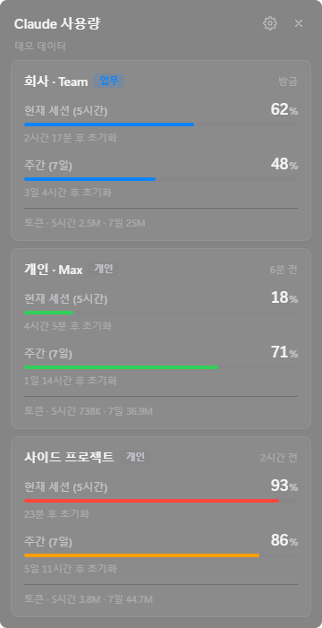

# Claude Code Multi-Account Widget

여러 Claude Code 계정(업무용 1개 + 개인용 최대 3개)의 **5시간 세션 한도**와 **주간 한도** 사용률, 초기화까지 남은 시간을 한눈에 보여주는 macOS / Windows 데스크톱 위젯입니다.



- 계정별 Activity Bar
- 초기화까지 남은 시간 실시간 카운트다운, 75% 주황 / 90% 빨강 경고
- 로컬 트랜스크립트 기준 토큰 사용량(5시간 / 7일) 보조 표시
- macOS: 반투명 vibrancy, SF Pro, iOS 그룹 리스트·스위치
- Windows 11: Acrylic 배경, Segoe UI Variable, Fluent 모서리·토글
- 트레이(메뉴 막대) 상주, 항상 위에 표시, 로그인 시 실행

## 동작 방식 — 토큰을 다루지 않습니다

```
Claude Code (계정 A, CLAUDE_CONFIG_DIR=~/.claude)            ┐
  └─ statusLine → .usage-widget/bridge  → snapshot.json      │  위젯이 파일만 읽음
Claude Code (계정 B, CLAUDE_CONFIG_DIR=~/.claude-personal)   │  (네트워크 X, 자격증명 X)
  └─ statusLine → .usage-widget/bridge  → snapshot.json      ┘
```

Claude Code는 Pro / Max 구독 계정에 대해 상태줄(status line) 스크립트의 입력 JSON에 [`rate_limits.five_hour` / `rate_limits.seven_day`](https://code.claude.com/docs/en/statusline)(사용률 %, 초기화 시각)를 공식적으로 넘겨줍니다. 위젯은 각 계정 설정 폴더의 `settings.json`에 작은 브리지 스크립트를 상태줄로 등록하고, 브리지는 **그 숫자들과 모델 이름만** `<설정폴더>/.usage-widget/snapshot.json`에 기록합니다.

| 하지 않는 것 | |
|---|---|
| `.credentials.json` / 키체인 읽기 | ✗ |
| OAuth·API 토큰 수집, 저장, 전송 | ✗ |
| 외부 서버 통신 (Anthropic API 포함) | ✗ |
| 세션 ID, 프롬프트, 경로 등 기타 상태줄 입력 저장 | ✗ |

기존에 쓰던 상태줄이 있다면 `previous-statusline.json`에 보관하고 브리지가 **같은 입력으로 그대로 실행**하므로 화면은 변하지 않습니다. 연결 해제나 계정 삭제 시 원래 설정으로 되돌리며, 처음 수정할 때 `settings.json.usage-widget.bak` 백업도 남깁니다.

### 검증된 지원 범위와 한계

- **Pro / Max 구독 계정**: 5시간·주간 사용률과 초기화 시각 표시 ✅
- **API 키 / Bedrock / Vertex 사용 계정**: Claude Code가 `rate_limits`를 주지 않으므로 "한도 정보 미제공"으로 표시하고 로컬 토큰 수만 보여줍니다.
- 값은 **해당 계정으로 Claude Code를 사용할 때** 갱신됩니다(첫 응답 이후). 쉬고 있는 계정은 마지막 값과 "n분 전"을 표시하고, 초기화 시각이 지나면 0%로 바꿔 보여줍니다. claude.ai 웹/앱에서 쓴 양은 다음 Claude Code 응답 때 반영됩니다.
- Team / Enterprise 좌석에서 `rate_limits` 제공 여부는 플랜 설정에 따라 다를 수 있습니다. 없으면 API 키 계정과 동일하게 동작합니다.

## 계정 준비 (계정마다 설정 폴더 분리)

Claude Code는 `CLAUDE_CONFIG_DIR` 환경 변수로 설정·로그인 폴더를 분리할 수 있습니다. 업무용은 기본 `~/.claude`, 개인용은 `~/.claude-personal` 같은 별도 폴더를 쓰면 됩니다.

macOS / Linux

```bash
CLAUDE_CONFIG_DIR="$HOME/.claude-personal" claude
```

Windows (PowerShell)

```powershell
$env:CLAUDE_CONFIG_DIR="$HOME\.claude-personal"; claude
```

처음 실행 시 `/login`으로 해당 계정에 로그인하세요. 위젯의 계정 카드와 편집 화면에서 이 명령을 클릭 한 번으로 복사할 수 있습니다. 자주 쓴다면 셸 alias(`alias claude-me='CLAUDE_CONFIG_DIR=~/.claude-personal claude'`)를 추천합니다.

## 사용법

1. 위젯 실행 → **업무용 / 개인용 계정 추가** → 이름과 설정 폴더 지정
2. 폴더가 이미 있으면 상태줄이 자동 연결됩니다. 없으면 위 명령으로 로그인한 뒤 **상태줄 연결**을 누르세요.
3. 그 계정으로 Claude Code에서 메시지를 한 번 보내면 카드가 채워집니다.

트레이 아이콘 클릭으로 보이기/숨기기, 우클릭 메뉴에서 항상 위에 표시·로그인 시 실행·위치 초기화·종료를 설정합니다. 헤더를 드래그해 위치를 옮길 수 있고 위치는 기억됩니다.

## 개발

필요: Node.js 20+ (CI는 22)

```bash
npm install
```

```bash
npm run dev          # 개발 모드: 저장하면 바로 반영 (실제 계정)
```

```bash
npm run dev -- --demo   # 개발 모드 + 데모 데이터
```

개발 모드에서는 `src/renderer/` 파일을 저장하면 위젯이 그 자리에서 바로 바뀌고(Vite HMR), `src/main/`·`src/shared/`·`src/bridge/`를 저장하면 자동으로 다시 컴파일한 뒤 앱이 재시작됩니다. UI의 `console.log`와 오류는 `[ui:…]`로 터미널에 찍힙니다. 끝낼 때는 터미널에서 Ctrl+C를 누르거나 트레이 메뉴의 **종료**를 누르세요.

```bash
npm start            # 배포용과 같은 방식으로 빌드 후 실행
```

```bash
npm run demo         # 빌드 후 데모 데이터로 실행
```

```bash
npm test             # vitest (Windows에서는 PowerShell 브리지 E2E 포함)
```

```bash
npm run dist:mac     # .dmg / .zip  (macOS에서)
npm run dist:win     # NSIS 설치본 / portable .exe  (Windows에서)
```

`v*` 태그를 푸시하면 GitHub Actions가 macOS·Windows 설치본을 빌드해 드래프트 릴리스에 올립니다(서명 없음).

### 구조

```
src/
  main/        Electron 메인 프로세스
    index.ts       창 · 트레이 · IPC · 갱신 루프
    accounts.ts    계정 저장소 (업무 1 / 개인 3 제한, 폴더 중복 방지)
    statusline.ts  settings.json 상태줄 설치/복원
    usage.ts       snapshot 읽기, 로컬 트랜스크립트 토큰 집계
    preload.ts     렌더러에 노출하는 최소 API (contextIsolation + sandbox)
  bridge/      상태줄 브리지 (macOS·Linux: Node, Windows: PowerShell)
  renderer/    위젯 UI (React + TypeScript, Vite로 번들)
    main.tsx       진입점
    App.tsx        화면 전환 (home / settings / edit)
    views/         화면 단위 컴포넌트 (HomeView, SettingsView, EditView)
    components/    재사용 컴포넌트 (AccountCard, UsageRings, Header, Toast, Icons…)
    hooks/         useWidgetState(메인 프로세스 상태 구독), useNow, useAutoResize
    lib/           api(window.widget), 경고 색상·실행 명령 등 UI 로직
    styles.css     디자인 전체 (:root 토큰, .platform-win 덮어쓰기, 다크 모드)
  shared/      타입, 포맷터 (메인·렌더러 공용)
test/          vitest
```

### UI 수정 가이드

- **디자인**: `styles.css`의 `:root` 변수(색상, 모서리, 간격)부터 바꾸세요. Windows 전용 값은 `.platform-win` 블록에 있습니다.
- **카드 내용**: `components/AccountCard.tsx`. 경고 기준(75% / 90%)은 `lib/usage.ts`의 `WARN_AT`, `DANGER_AT`.
- **새 화면**: `views/`에 컴포넌트를 만들고 `App.tsx`의 `Route` 타입과 분기에 추가합니다.
- **메인 프로세스 기능 호출**: `src/shared/types.ts`의 `WidgetApi` → `src/main/preload.ts` → `src/main/index.ts`의 `registerIpc()` 순서로 추가하면 렌더러에서 `api.새기능()`으로 쓸 수 있습니다.
- **스크린샷**: `npm run build` 후 `npx electron . --demo --capture=shot.png`. 화면을 넘기려면 `CAPTURE_CLICK="[aria-label=설정]|button.row"`처럼 클릭할 셀렉터를 `|`로 이어 환경 변수로 넘깁니다.

### 플랫폼별 메모

- **Windows**: Claude Code는 상태줄 명령을 Git Bash(있으면) 또는 PowerShell로 실행합니다. 브리지 명령은 두 셸 모두에서 동작하도록 `powershell -NoProfile -ExecutionPolicy Bypass -File "C:/…/bridge.ps1"` 형태(슬래시 경로)로 등록됩니다. `-ExecutionPolicy Bypass`는 해당 프로세스에만 적용되며 시스템 정책은 바꾸지 않습니다.
- **macOS**: 로그인 셸에 `node`가 있으면 그것을, 없으면 위젯 앱의 내장 런타임(`ELECTRON_RUN_AS_NODE=1`)으로 브리지를 실행합니다. 서명되지 않은 빌드는 처음 열 때 우클릭 → 열기가 필요합니다.

## 라이선스

MIT
